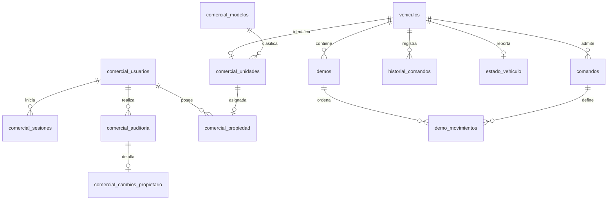
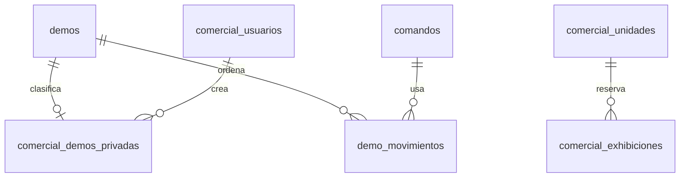

# Práctica 4.3 · Administración comercial

## Administración y acceso de compradores

La vista `administracion.html` añade acceso de administrador, resumen del inventario, búsqueda paginada de modelos, unidades y clientes, y formularios de alta, edición y baja lógica de modelos y compradores. Los cambios comerciales y su auditoría se confirman en una misma transacción. Cada unidad física conserva el `id_vehiculo` de Control y Monitoreo. Las altas efectuadas desde el catálogo antiguo aparecen en el inventario aunque aún falte clasificarlas.

El acceso comercial se habilita por entorno. El administrador utiliza correo y contraseña. MySQL conserva una derivación scrypt con sal aleatoria y sólo el resumen SHA-256 de los tokens de sesión. El administrador mantiene el token en memoria. El comprador lo conserva en la sesión de la pestaña para navegar entre sus unidades. El token vence al cabo de una hora y se invalida al salir. Cinco intentos fallidos consecutivos bloquean la cuenta durante diez minutos. Dar de baja a un cliente invalida sus sesiones comerciales. El código compartido funciona en el despliegue anterior. En modo comercial, el mando y el monitor requieren la sesión de un comprador y la propiedad de la unidad. En modo comercial, `DEVICE_TOKEN` identifica la placa de `DEVICE_VEHICLE_ID` (por defecto 1). Para más placas, `DEVICE_TOKENS_POR_UNIDAD` admite un objeto JSON privado que asocia cada ID físico con su propia credencial. La API rechaza claves repetidas y el código compartido de navegador en el canal de dispositivo. La nueva vista no solicita un permiso de conducción ni abre conexiones WSS.

## Diagnóstico del proyecto original

| Función | Decisión | Contrato o relación |
| --- | --- | --- |
| Vehículo, comandos, estado y DEMO | Se reutiliza | GET bajo `/admin/vehiculos/{id}`, con los esquemas de 4.1/4.2 y el permiso operativo correspondiente. |
| Movimiento y parada | Se reutiliza | `POST /vehiculos/{id}/movimientos` usa el ID del comando. El control físico conserva sus leases, latidos, secuencia y parada. |
| Historial individual | Se reutiliza | `GET /vehiculos/{id}/historial?limite=10`. El contrato anterior admite lectura sin autenticación. En modo comercial, exige sesión y propiedad. |
| Ejecución de DEMO | Se reutiliza | `POST /vehiculos/{id}/demos` y `DELETE /vehiculos/{id}/demos/activa`. Los pasos de DEMO se registran en el canal de eventos. |
| Canal WSS | Se autoriza por propietario | `/ws/vehiculos/{id}`. Control y Monitor reciben estado inicial y eventos del vehículo. Las credenciales previas son de dispositivo o código de acceso. |
| Clientes y sesiones comerciales | Se crea | Correo único, rol, cuenta activa, hash de contraseña, caducidad y revocación. |
| Modelo comercial y unidad física | Se modifica la representación comercial | Se conserva `vehiculos`. Un catálogo de modelos y una relación por ID añaden clasificación comercial. Las unidades previas quedan sin clasificar o inactivas. |
| Asignaciones | Implementado | Un comprador puede tener varias unidades. Cada unidad admite un propietario vigente. |
| Reservas y demos privadas | Pendiente | Requieren capacidades y reserva exclusiva por unidad. |

La API original publica su contrato en [Swagger](https://cape-landside-tidy.ngrok-free.dev/docs). En el inventario inicial de RDS se identificaron seis tablas, 21 procedimientos, cero vistas, cero disparadores y cero eventos programados en el esquema. `historial_comandos.id_historial` es BIGINT. Los IDs de vehículo, comando, demo y paso son INT con signo. Hay claves únicas de comando por vehículo y código, comando por vehículo y nombre, y orden de paso por demo.

## Esquema implementado

La asignación y la auditoría de los propietarios anterior y nuevo se guardan en una transacción. El historial de movimientos permanece ligado a la unidad. La compatibilidad de comandos se definirá por modelo. El editor ampliará `demos` y `demo_movimientos` con visibilidad y titularidad. La prueba de invitados necesitará una reserva exclusiva y una sesión con vencimiento y parada. Estos elementos aún no forman parte del esquema aplicado en el ensayo.

## API comercial implementada

| Método y recurso | Uso | Respuesta habitual |
| --- | --- | --- |
| POST `/comercial/acceso` | Correo y clave de cuenta activa | 200 con token, nombre y rol. 401 credenciales inválidas o 429 bloqueo temporal |
| DELETE `/comercial/sesion` | Cierre mediante token Bearer | 204 |
| GET `/comercial/resumen` | Totales consultados en MySQL | 200 |
| GET `/comercial/unidades` | ID físico, nombre, modelo, estado y propietario | 200 |
| PUT `/comercial/unidades/{id}/propietario` | Administrador. `id_usuario` identifica al comprador nuevo y `anterior` identifica al titular mostrado. Usar `null` para indicar ausencia de propietario | 204, o 409 si el titular cambió o sigue una operación en curso |
| GET `/comercial/mis-vehiculos` | Unidades activas del comprador autenticado | 200, incluida una lista vacía |
| GET, POST `/comercial/modelos` | Buscar o registrar modelo | 200, 201 |
| PUT `/comercial/modelos/{id_modelo}` | Actualizar o desactivar modelo | 200 |
| GET, POST `/comercial/clientes` | Buscar o registrar comprador con rol usuario | 200, 201 |
| PUT `/comercial/clientes/{id_usuario}` | Editar datos o desactivar un comprador | 200 |

Los listados administrativos admiten `buscar`, `inicio` y `limite` (1–100). Inventario y mantenimiento exigen sesión administrativa. Respuestas previstas: 401 sin sesión válida, 403 para roles insuficientes, 404 para recurso desconocido, 409 por conflicto de unicidad y 422 por datos inválidos. Desde «Mis vehículos» el comprador abre el mando o el monitor de la unidad elegida. Cambiar el identificador de la URL exige una nueva autorización en FastAPI.

La comprobación cubre el catálogo por unidad, estado, historial, movimientos, demos, control físico y canales WebSocket, incluidos sus alias anteriores. La transferencia cierra los canales de la unidad y espera el cierre de los mandos en vuelo. Una operación física o demo independiente que siga activa impide completar la transferencia. Cerrar sesión, desactivar la cuenta o alcanzar el vencimiento corta sus canales. El servidor de control utiliza un único proceso Uvicorn, como exige el coordinador de las prácticas anteriores.

## Ensayo de migración y recuperación

1. Conservar un respaldo privado del esquema original con estructura, datos y rutinas, en una instantánea transaccional. Restaurarlo en un MySQL aislado. La cuenta de despliegue necesita permisos adecuados para leer las definiciones de rutinas. Revisar el usuario DEFINER y los permisos de ejecución de la copia.
2. Capturar conteos e identificadores antes de la migración. Aplicar, en orden, [001_catalogo.sql](../migrations/4.3/001_catalogo.sql), [002_unidades_existentes.sql](../migrations/4.3/002_unidades_existentes.sql), [003_verificar.sql](../migrations/4.3/003_verificar.sql), [004_propiedad.sql](../migrations/4.3/004_propiedad.sql) y [005_demos_exhibicion.sql](../migrations/4.3/005_demos_exhibicion.sql). Revisar las unidades sin coincidencia de modelo. Una unidad sin clasificar permanece fuera de toda exhibición pública.
3. En el ensayo del 20 de noviembre de 2026 se restauró el respaldo de RDS MySQL 8.4.11 en MySQL 8.0.42 local. Se aplicó dos veces la secuencia. Se compararon las seis tablas originales por conteo y huella de sus filas ordenadas por clave primaria. Permanecieron iguales los cuatro vehículos, veinte comandos, cinco demos, quince pasos, tres estados y 2.605 registros de historial. Se vincularon cuatro unidades. Se conservaron los 21 procedimientos y se invocó el procedimiento de historial sobre la copia.
4. Para volver a 4.2, utilizar un destino separado del inventario privado. La versión anterior usa código compartido y admite historial público. El DDL de MySQL puede efectuar commit implícito. Para retirar también el esquema comercial, restaurar la copia verificada en una base separada, conciliar las escrituras posteriores y validar el cambio de destino. Conservar el historial y la auditoría antes de cualquier sustitución. Una vuelta sólo de aplicación mantiene las nuevas restricciones referenciales sobre las unidades vinculadas.
5. Antes del despliegue definitivo repetir el ensayo sobre MySQL 8.4 compatible con el motor de RDS y obtener respaldo actualizado. El respaldo con datos y los archivos de acceso permanecen fuera de Git.

## Ejecutar en un ambiente de prueba

- Backend: configurar las variables MySQL del proyecto para la copia restaurada. Activar `COMERCIAL_HABILITADO=true`. Después de las migraciones, ejecutar `python -m scripts.crear_admin_comercial` desde la raíz. La clave se introduce en forma interactiva. Arrancar con `python -m uvicorn app.main:app`.
- Frontend: establecer `IOT_COMERCIAL_HABILITADO=1` e `IOT_API_URL` con el origen de esa API. Compilar con `node control-iot/build.mjs` y servir `control-iot/dist`. Abrir `administracion.html` para asignar unidades y `mis-vehiculos.html` para acceder como comprador. En Vercel producción la compilación habilita el acceso comercial por defecto. GitHub Pages usa la variable `IOT_COMERCIAL_HABILITADO` del repositorio. Con la administración habilitada, CORS incorpora PUT para los orígenes autorizados.
- GitHub Pages y Vercel compilan la misma carpeta. La variable pública de compilación es la misma en ambos. Las rutas de navegación y archivos son relativas para soportar la subruta de Pages.
- Para probar sesiones y transacciones, configurar `MYSQL43_TEST_PORT` y `MYSQL43_TEST_PASSWORD` para una instancia MySQL **local de ensayo** y ejecutar `python -m unittest tests.test_comercial_mysql -v`. La prueba crea un esquema con nombre aleatorio y lo retira al finalizar.

## Alcance de la validación

La prueba en Edge cubrió ingreso, creación, edición y desactivación de modelos y clientes, listado de las cuatro unidades, salida y diseño en tres tamaños. La vista administrativa abrió cero WebSockets. Las pruebas de integración cubrieron caducidad, revocación, separación de roles, unicidad, transacción de auditoría y activación opcional. Control y Monitoreo se comprobaron contra la copia y, por separado, en las dos publicaciones vigentes, mediante lecturas y suscripción WSS.

En el ensayo de propiedad se probaron dos compradores, el cambio de propietario con canales abiertos, el bloqueo del código anterior sobre unidades privadas y un comprador con varias unidades. En Edge se verificó la selección, el control y el historial en la raíz y en la subruta de Pages con la API local. Los sitios públicos de 4.1/4.2 entregaron estado por WSS y diez movimientos desde AWS.

## Unidades, demos y exhibición

Administración permite dar de alta una unidad, vincularla con un modelo activo, editarla y darla de baja conservando su ficha y su historial. La placa se identifica por el ID físico y conserva su propia credencial. La columna **Placa** se lee del servidor que recibe la conexión. Cambiar el modelo o dar de baja una unidad con comprador requiere retirar primero la asignación.

| Método y recurso | Permiso y resultado |
| --- | --- |
| GET `/salud` | Público. Informa por separado la disponibilidad de la API y el resultado de una consulta real a MySQL |
| POST `/comercial/unidades` | Administración. Alta de unidad con modelo y estado |
| PUT `/comercial/unidades/{unidad}` | Administración. Edición y baja lógica |
| GET `/comercial/auditoria` | Administración. Eventos ordenados con actor, fecha, acción, recurso y resultado |
| GET, POST `/comercial/unidades/{unidad}/secuencias` | Catálogo y alta de demos. Administración edita las de fábrica. Cada comprador edita sus propias demos |
| GET, PUT, DELETE `/comercial/unidades/{unidad}/secuencias/{demo}` | Consulta, edición y baja lógica. Los pasos ordenados se guardan junto con la ficha y su auditoría |
| GET `/exhibicion/catalogo` | Catálogo público de modelos activos. Disponibilidad de unidades condicionada al modo de exhibición |
| WSS `/exhibicion/ws/{unidad}` | Sesión exclusiva para una unidad activa de exhibición sin comprador, con placa preparada y activación explícita en AWS |

Cada demo nueva utiliza comandos vigentes de la unidad. El editor admite hasta 32 pasos y 120 segundos totales, incluidas las pausas. Control usa el ejecutor de DEMO existente y DETENER conserva su prioridad. Un cambio de propietario retira la visibilidad y el permiso de ejecución de las demos privadas del titular anterior. Los pasos de DEMO siguen fuera del historial individual. La lectura de pasos y la ejecución verifican los permisos en el servidor.

La migración 005 agrega una relación entre demo privada y comprador y un registro de sesiones de exhibición. La restricción única de unidad reservada impide dos reservas vigentes. El canal público aplica un límite de 45 segundos, pulsos de 200 ms para los códigos de pala permitidos y un latido. DETENER termina la sesión. El servidor solicita parada y registra el cierre al expirar, al desconectar o al pulsar DETENER. El watchdog local del firmware cubre la pérdida del enlace. `EXHIBICION_HABILITADA=false` mantiene la exhibición sin disponibilidad pública.

La aplicación de la migración 005 en RDS conservó 2.616 registros de historial, 21 procedimientos y las tres asignaciones vigentes. La versión temporal respondió desde EC2 y leyó RDS. La activación pública requiere que el servicio del vehículo y el túnel HTTPS estén disponibles.

La persona propietaria confirmó desde su celular que el carro se mueve y se detiene. La evaluación colaborativa de las tres plataformas y la prueba física supervisada de invitados requieren a los participantes y una unidad destinada a exhibición. [Matriz P01–P17](MATRIZ-4-3.md)
