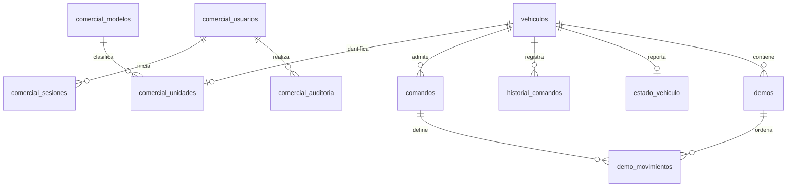

# Práctica 4.3 · Administración comercial

## Primera entrega de desarrollo

La vista `administracion.html` añade acceso de administrador, resumen del inventario, búsqueda paginada de modelos, unidades y clientes, y formularios de alta, edición y baja lógica de modelos y compradores. Los cambios comerciales y su auditoría se confirman en una misma transacción. Cada unidad física conserva el `id_vehiculo` de Control y Monitoreo. Las altas efectuadas desde el catálogo antiguo aparecen en el inventario aunque aún falte clasificarlas.

El acceso comercial se habilita por entorno. El administrador utiliza correo y contraseña. MySQL conserva una derivación scrypt con sal aleatoria y sólo el resumen SHA-256 de los tokens de sesión. El token del navegador queda en memoria, vence al cabo de una hora y se invalida al salir. Cinco intentos fallidos consecutivos bloquean la cuenta durante diez minutos. Dar de baja a un cliente invalida sus sesiones comerciales. El código de operación anterior sigue reservado a las rutas de 4.1/4.2. La nueva vista no solicita un permiso de conducción ni abre conexiones WSS.

## Diagnóstico del proyecto original

| Función | Decisión | Contrato o relación |
| --- | --- | --- |
| Vehículo, comandos, estado y DEMO | Se reutiliza | GET bajo `/admin/vehiculos/{id}`, con los esquemas y el código de acceso de 4.1/4.2. |
| Movimiento y parada | Se reutiliza | `POST /vehiculos/{id}/movimientos` usa el ID del comando. El control físico conserva sus leases, latidos, secuencia y parada. |
| Historial individual | Se reutiliza | `GET /vehiculos/{id}/historial?limite=10`. El contrato anterior admite lectura sin autenticación. Su autorización por propietario está pendiente antes de introducir unidades privadas. |
| Ejecución de DEMO | Se reutiliza | `POST /vehiculos/{id}/demos` y `DELETE /vehiculos/{id}/demos/activa`. Los pasos de DEMO se registran en el canal de eventos. |
| Canal WSS | Existe y queda pendiente de ampliar por propietario | `/ws/vehiculos/{id}`. Control y Monitor reciben estado inicial y eventos del vehículo. Las credenciales previas son de dispositivo o código de acceso. |
| Clientes y sesiones comerciales | Se crea | Correo único, rol, cuenta activa, hash de contraseña, caducidad y revocación. |
| Modelo comercial y unidad física | Se modifica la representación comercial | Se conserva `vehiculos`. Un catálogo de modelos y una relación por ID añaden clasificación comercial. Las unidades previas quedan sin clasificar o inactivas. |
| Asignaciones, reservas y demos privadas | Pendiente | Requieren propietario autorizado, capacidades y reserva exclusiva por unidad. El panel aún no ofrece venta ni control de invitados. |

La API original publica su contrato en [Swagger](https://cape-landside-tidy.ngrok-free.dev/docs). En el inventario inicial de RDS se identificaron seis tablas, 21 procedimientos, cero vistas, cero disparadores y cero eventos programados en el esquema. `historial_comandos.id_historial` es BIGINT. Los IDs de vehículo, comando, demo y paso son INT con signo. Hay claves únicas de comando por vehículo y código, comando por vehículo y nombre, y orden de paso por demo.

## Esquema implementado

La siguiente ampliación relacionará comprador y unidad mediante una asignación vigente, con historial de reasignación. La compatibilidad de comandos se definirá por modelo. El editor ampliará `demos` y `demo_movimientos` con visibilidad y titularidad. La prueba de invitados necesitará una reserva exclusiva y una sesión con vencimiento y parada. Estos elementos aún no forman parte del esquema aplicado en el ensayo.

## API comercial implementada

| Método y recurso | Uso | Respuesta habitual |
| --- | --- | --- |
| POST `/comercial/acceso` | Correo y clave de cuenta activa | 200 con token, nombre y rol. 401 credenciales inválidas o 429 bloqueo temporal |
| DELETE `/comercial/sesion` | Cierre mediante token Bearer | 204 |
| GET `/comercial/resumen` | Totales consultados en MySQL | 200 |
| GET `/comercial/unidades` | ID físico, nombre, modelo y estado comercial | 200 |
| GET, POST `/comercial/modelos` | Buscar o registrar modelo | 200, 201 |
| PUT `/comercial/modelos/{id_modelo}` | Actualizar o desactivar modelo | 200 |
| GET, POST `/comercial/clientes` | Buscar o registrar comprador con rol usuario | 200, 201 |
| PUT `/comercial/clientes/{id_usuario}` | Editar datos o desactivar un comprador | 200 |

Los listados admiten `buscar`, `inicio` y `limite` (1–100). Inventario y mantenimiento exigen sesión administrativa. Respuestas previstas: 401 sin sesión válida, 403 para roles insuficientes, 404 para recurso desconocido, 409 por conflicto de unicidad y 422 por datos inválidos. Una cuenta de comprador existe a efectos de registro y validación de roles. Todavía no dispone de la vista «Mis vehículos».

## Ensayo de migración y recuperación

1. Conservar un respaldo privado del esquema original con estructura, datos y rutinas, en una instantánea transaccional. Restaurarlo en un MySQL aislado. La cuenta de despliegue necesita permisos adecuados para leer las definiciones de rutinas. Revisar el usuario DEFINER y los permisos de ejecución de la copia.
2. Capturar conteos e identificadores antes de la migración. Aplicar, en orden, [001_catalogo.sql](../migrations/4.3/001_catalogo.sql), [002_unidades_existentes.sql](../migrations/4.3/002_unidades_existentes.sql) y [003_verificar.sql](../migrations/4.3/003_verificar.sql). Revisar las unidades sin coincidencia de modelo. Una unidad sin clasificar permanece fuera de toda exhibición pública.
3. En el ensayo del 20 de noviembre de 2026 se restauró el respaldo de RDS MySQL 8.4.11 en MySQL 8.0.42 local. Se aplicó dos veces la secuencia. Se compararon las seis tablas originales por conteo y huella de sus filas ordenadas por clave primaria. Permanecieron iguales los cuatro vehículos, veinte comandos, cinco demos, quince pasos, tres estados y 2.605 registros de historial. Se vincularon cuatro unidades. Se conservaron los 21 procedimientos y se invocó el procedimiento de historial sobre la copia.
4. Para volver a 4.2, desactivar los dos indicadores de habilitación y desplegar la revisión de respaldo. El DDL de MySQL puede efectuar commit implícito. Para retirar también el esquema comercial, restaurar la copia verificada en una base separada, conciliar las escrituras posteriores y validar el cambio de destino. Conservar el historial y la auditoría antes de cualquier sustitución. Una vuelta sólo de aplicación mantiene las nuevas restricciones referenciales sobre las unidades vinculadas.
5. Antes del despliegue definitivo repetir el ensayo sobre MySQL 8.4 compatible con el motor de RDS y obtener respaldo actualizado. El respaldo con datos y los archivos de acceso permanecen fuera de Git.

## Ejecutar en un ambiente de prueba

- Backend: configurar las variables MySQL del proyecto para la copia restaurada. Activar `COMERCIAL_HABILITADO=true`. Después de las migraciones, ejecutar `python -m scripts.crear_admin_comercial` desde la raíz. La clave se introduce en forma interactiva. Arrancar con `python -m uvicorn app.main:app`.
- Frontend: establecer `IOT_COMERCIAL_HABILITADO=1` e `IOT_API_URL` con el origen de esa API. Compilar con `node control-iot/build.mjs` y servir `control-iot/dist`. Abrir `administracion.html`. Ambos indicadores están desactivados por defecto. Con la administración habilitada, CORS incorpora PUT para los orígenes autorizados.
- GitHub Pages y Vercel compilan la misma carpeta. La variable pública de compilación es la misma en ambos. Las rutas de navegación y archivos son relativas para soportar la subruta de Pages.
- Para probar sesiones y transacciones, configurar `MYSQL43_TEST_PORT` y `MYSQL43_TEST_PASSWORD` para una instancia MySQL **local de ensayo** y ejecutar `python -m unittest tests.test_comercial_mysql -v`. La prueba crea un esquema con nombre aleatorio y lo retira al finalizar.

## Alcance de la validación

La prueba en Edge cubrió ingreso, creación, edición y desactivación de modelos y clientes, listado de las cuatro unidades, salida y diseño en tres tamaños. La vista administrativa abrió cero WebSockets. Las pruebas de integración cubrieron caducidad, revocación, separación de roles, unicidad, transacción de auditoría y activación opcional. Control y Monitoreo se comprobaron contra la copia y, por separado, en las dos publicaciones vigentes, mediante lecturas y suscripción WSS.

Quedan pendientes el ciclo completo de unidades, propiedad y control autorizado por unidad, la autorización para soporte, las demos privadas, las sesiones de exhibición, las pruebas físicas y la matriz P01–P17 de tres plataformas. La producción continúa en la revisión de 4.1/4.2.
